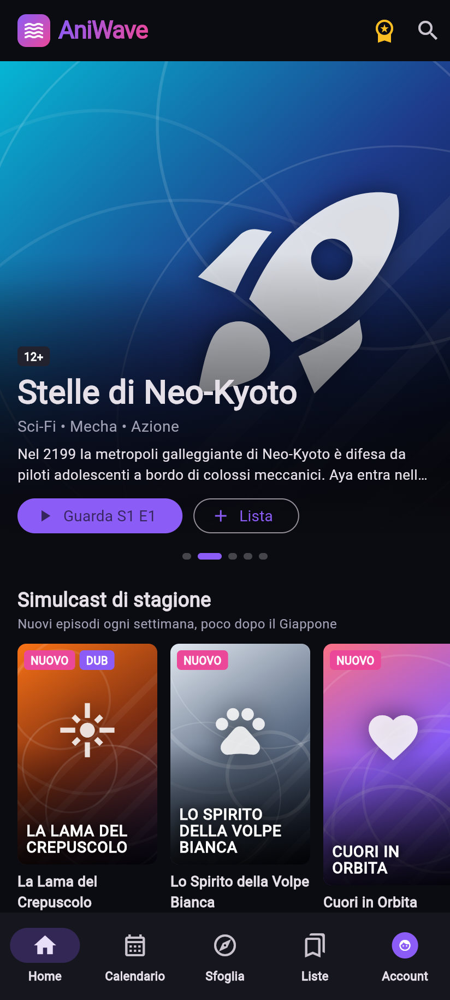
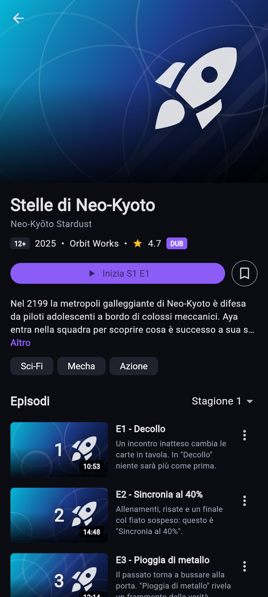
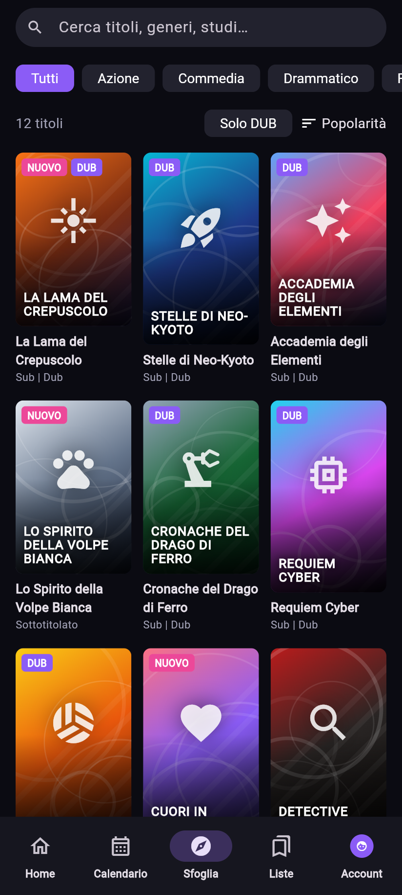
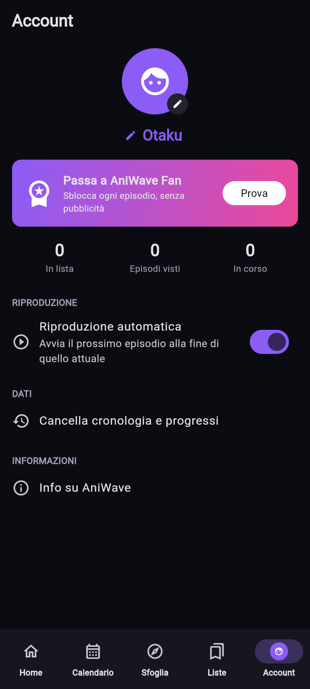

# AniWave

App Flutter di streaming anime ispirata all'esperienza di Crunchyroll, con **nome, logo, serie e grafica completamente originali**.

| Home | Serie | Sfoglia | Account |
|---|---|---|---|
|  |  |  |  |

## Funzioni

- **Home**: carosello in evidenza a scorrimento automatico, "Continua a guardare", simulcast, popolari, novità, doppiati e righe per genere.
- **Scheda serie**: info, valutazione, generi, stagioni, lista episodi con avanzamento, "Segna come visto" e "Più come questo".
- **Player video**: riprende da dove avevi lasciato, ±10 s (anche con doppio tocco), barra di avanzamento, velocità da 0.75x a 2x, "Salta intro", passaggio automatico all'episodio successivo con conto alla rovescia.
- **Calendario simulcast**: uscite settimanali giorno per giorno, con oggi già selezionato.
- **Sfoglia e ricerca**: ricerca che ignora maiuscole e accenti (anche per titolo originale e studio), filtri per genere, "Solo DUB" e ordinamento.
- **Le mie liste**: la tua lista e la cronologia, con il tempo che manca alla fine di ogni episodio.
- **Premium (demo)**: alcuni episodi sono bloccati e si sbloccano con "AniWave Fan" in modalità demo, senza nessun pagamento.
- **Account**: nome e avatar del profilo, riproduzione automatica, cancellazione della cronologia.
- Tutto viene **salvato sul dispositivo** (SharedPreferences).

## Contenuti

Le 12 serie del catalogo sono inventate e le copertine vengono generate dal codice (gradienti, motivi geometrici e icone), quindi non serve nessuna immagine esterna.
I video di prova sono i cortometraggi open della Blender Foundation (*Big Buck Bunny*, *Elephants Dream*, *Sintel*, *Tears of Steel*), con licenza Creative Commons.

## Avvio

```bash
flutter pub get
flutter run            # Android / iOS
flutter run -d chrome  # Web
flutter test
```

## Compilazione automatica

A ogni push, GitHub Actions (`.github/workflows/build.yml`) analizza il codice, esegue i test e compila l'APK Android.
L'APK finisce nella pagina **Releases** del repository, pronto da scaricare e installare sul telefono.
Puoi anche avviarla a mano: tab **Actions** → **Build APK** → **Run workflow**.

In alternativa c'è `codemagic.yaml`, che ti manda l'APK per email.

## Struttura

```
lib/
  main.dart               app e barra di navigazione
  theme.dart              colori e tema scuro
  data/catalog.dart       serie, episodi, ricerca
  state/app_state.dart    lista, progressi, cronologia, impostazioni
  widgets/                copertine generate, card, righe
  screens/                home, serie, player, calendario, sfoglia, liste, account
```

## Prossimi passi possibili

- Backend reale (Firebase) con login e sincronizzazione tra dispositivi
- Sottotitoli e scelta della traccia audio
- Download per la visione offline
- Notifiche per le nuove uscite simulcast
